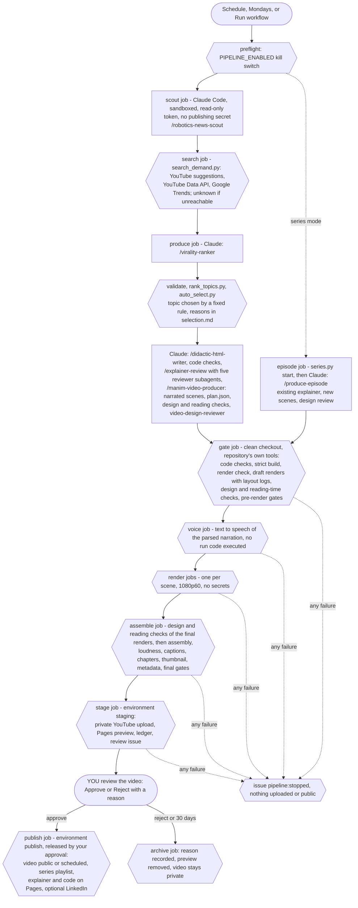

# Remaining Action: robotics explainers and their video series

The pipeline behind **Remaining Action**, a YouTube channel that explains robotics and control research with the
equations and the code. It turns a **didactic, verified HTML explainer** into **narrated Manim videos**, with the
rigor of a research note: every number printed by a script, every reference checked against a record, independent
reviewers, rendering checks and hard gates.

**How it is used now: from a source document to a finished episode, in a Claude Code cloud session.** Put an
explainer in `sources/<name>/explainer.html` (with its companion `code/` and `data/` when it has them), open a
session on this repository and type `/produce-from-source sources/<name>`. Claude plans the series when the source
has none (a curator and an independent red team; no plan approval needed), makes the next episode with every check
and review, renders it at 1080p with the Piper voice, has the assembled video watched by an independent reviewer,
and hands you a folder: the MP4, the captions, the thumbnail, an upload sheet (title, description, tags, chapters,
settings) and the YouTube Studio checklist. **The only human step is yours: watch the video and upload it by hand.**
Claude uploads, commits and pushes nothing. [`CLOUD-SESSION.md`](CLOUD-SESSION.md) has the environment settings,
"Adding a new source" below the steps for the next document.

**Optional: the news pipeline, unattended in GitHub Actions.** Every week it can turn current robotics news into an
explainer and a video, upload it privately and wait for your approval (a GitHub deployment review that Claude cannot
give) before anything is public. It is not set up now; [`SETUP-AUTOMATION.md`](SETUP-AUTOMATION.md) describes it. Its
stages:

1. **Scout** recent robotics news and research, following each story to its primary source.
2. **Rank** candidate topics with an explicit, inspectable rubric that includes measured search demand and the gap
   in existing coverage (a heuristic, not a prediction of virality).
3. **Select** the topic automatically by a fixed rule, with the reasons logged (or let the user choose, in
   `human` mode).
4. **Write** a self-contained HTML explainer in the house style, with companion code behind every number and figure.
5. **Review** it with five independent reviewer subagents (one reads strictly front to back and reports every gap
   in the argument), verify their serious findings, fix, recheck.
6. **Animate** the key ideas as narrated Manim scenes; check every draft for design problems and reading time, with a
   deterministic checker and an independent video design reviewer; plan title, chapters and thumbnail.
7. **Gate, render, assemble** on a clean checkout: 1080p60 with the Piper narration, the hook first and the outro
   scene last (no channel card), captions, chapters from the plan's chapter titles, thumbnail, description (explainer
   and code links only when turned on).
8. **Upload privately and ask you.** Approve: public video, explainer and code on GitHub Pages, optional LinkedIn
   post. Reject: archived with your reason.

**Series mode** turns a source explainer into planned series of episodes, one per run, with the same checks and
review; with the workflow it also adds each published episode to the series playlist (see below).
[`sources/variational-whole-body-control/`](sources/variational-whole-body-control/) is the first source document
(explainer, companion code, data); its series are planned anew by `/produce-from-source` (the earlier plans were
removed on 2026-11-01).

## Automated architecture



Rounded boxes are triggers and you, hexagons deterministic scripts, rectangles Claude.

| Job | Runs Claude | Runs code written during the run | Secrets and permissions |
|---|---|---|---|
| scout, produce, episode | yes | yes (its own checks) | Claude key only (scrubbed from subprocesses); `contents: read`; sandbox, no network for Bash |
| search | no | no | read-only YouTube Data API key (optional); its output's hash is checked before ranking |
| gate, render | no | yes (code checks, scenes) | none; `contents: read` |
| voice | no | no (scene files are parsed) | none for Piper (default); a text-to-speech key only for `azure` |
| assemble | no | no | none |
| stage | no | no | YouTube (environment `staging`), `contents` and `issues: write` for Pages and the issue |
| publish | no | no | YouTube and LinkedIn (environment `publish`, released only by your approval) |

`tools/lint_project.py --automation` enforces this table on every push.

### What the automation adds, item by item

| Need | How it is met | Where |
|---|---|---|
| Unattended trigger | GitHub Actions schedule plus manual dispatch, `claude-code-action` in automation mode, kill switch, one run at a time. Alternative: a Claude Code routine (scheduled task on claude.ai) for the Claude part, pushing the run to a branch that triggers the rest; not used because its secrets and network live in a shared cloud environment, and rendering needs this toolchain | `.github/workflows/pipeline.yml` |
| Rendering in CI | Container image (Manim, TeX Live, dvisvgm, Pango/Cairo, ffmpeg, Node, Playwright, KaTeX) built once and cached in GHCR; one render job per scene at 1080p60, in parallel | `docker/Dockerfile`, `ci-image.yml` |
| Narration and captions | manim-voiceover; one setting `voice.service`: `piper` (default, the voice of final renders; offline neural voice, no key; a final render without its model stops and says how to get it), `azure`, `recorded` (your voice), `silent` (draft renders); no fallback voice; one SRT caption file per scene, merged; bookmarks synced with word timings (Piper's estimated sentence by sentence) | `templates/manim/voice.py`, `tools/video/synthesize_voice.py`, `tools/video/piper_model.py` |
| Assembly | The scenes in plan order, no card added: the video opens with the hook (a full moving picture from frame 0, music, narration by 3 s, the question by 15 s, no channel card) and ends with the plan's outro scene (takeaway card, channel name, teaser, the end-screen area empty); normalized segments; a narration stem; original music from `tools/video/music.py` (seeded, stamped, per scene `bed`/`low`/`off`, ducked under the voice with look-ahead); two-pass loudness to -14 LUFS with the true peak at most -1 dBTP measured after encoding; chapters from the plan's own chapter titles (YouTube rules: start 0:00, three or more, 10 s each), thumbnail from an original frame (on a calm dark panel, or picture first with a title band), title, description with the music credit, tags | `tools/video/` |
| Series planning | `/plan-series` (or the first step of `/produce-from-source`): curator and red-team subagents, schema-2 plans validated by `tools/series.py validate`; the owner's plan approval only when `series.plan_approval` is `required` (it is `optional`) | `.claude/skills/plan-series/`, `tools/series.py`, `tools/human/approve_series.py` |
| Opening, ending, series beats | Hook first (full picture at frame 0, narration by 3 s, question by 15 s, body by 45 s, the thumbnail's picture within 15 s), a short title beat (`title_beat()`), the signature `meter()`, outro 15-20 s with the channel name and the end-screen area empty; in series episodes the spoken context over the builds-on frame, marked recaps of every must prerequisite, the teaser; helpers `builds_on()`, `recap_tag()`, `recap_card()`, `takeaway_card()`, `outro()`; warnings from `check_series.py` | `templates/manim/common.py`, `tools/video/check_series.py` |
| Number format | `fmt()`: 2-3 significant digits for readouts, no trailing zeros, exact values exact, a real minus sign, never a signed zero (`sign=True` for +0.14); live readouts with fixed decimals; one precision per quantity in a scene; a check of the layout logs (readouts sampled over time), narration, captions, chapters and thumbnail (errors fail the gate) | `templates/manim/reading_model.py`, `tools/video/check_numbers.py` |
| Space and motion | Warnings for lopsided or wasted frames and small pictures (settled frames), overlaps while things move and readouts whose width jumps (the probe's 15 fps timeline) | `tools/video/check_design.py` |
| Final-cut review | Someone watches the assembled video: frames every 2 s, at scene changes, chapter starts and after scenes, with captions; the `final-cut-reviewer` subagent reports with timestamps, a verifier checks blockers and majors, and the release gate (`tools/gate.py --stage release`) stops the private upload on an open blocker; a session without subagents says so and the review is marked not independent | `.claude/skills/final-cut-review/`, `tools/video/final_frames.py` |
| Self-contained video | The video assumes nothing else exists: no reference to the explainer, code, files, links or the description, no document numbering and no equation labels (`equation_numbers` in `config/video.json`, default false), no references to other episodes; a deterministic check on the layout logs, narration, captions and chapters, in the gates and in `check_video.py` (it leaves mentions of other episodes, "episode", "series", "previously", "next time", to the reviewers and rejects only their equation numbers, "equation 4 of episode 2") | `tools/video/check_selfcontained.py` |
| Links (opt-in) | Off by default: the description carries no explainer, code or site link. On for every run with `links.include` in `config/channel.json`, or for one run with the pipeline's `links` input: then the explainer and code links go in the YouTube description only, never in the video (needs `SITE_BASE_URL`) | `tools/video/metadata.py` |
| Review package and approval | Private upload, preview on Pages, one review issue; approval is a deployment review on environment `publish` (or a label only `APPROVER_LOGIN` counts for) | `stage`, `publish-run.yml`, `archive-run.yml`, `approve-by-label.yml` |
| Hard gates | Pre-render and final gates (below); any failure stops the run before upload | `tools/gate.py` |
| YouTube API realities | OAuth refresh token as an environment secret; quota about 2,200 units per run; unaudited projects stay private (manual-upload mode meanwhile); thumbnail needs a verified channel; made-for-kids and synthetic-media declarations set per video | `tools/publish/youtube.py`, SETUP-AUTOMATION.md |
| Safety and operations | Secrets only in Actions environments; least-privilege tokens per job; kill switches; idempotent upload (run marker, ledger); logs, summaries and artifacts; turn and dollar caps; issues as notifications; Claude Code sandbox; publish guard kept as defense in depth | workflows, `ci/claude-ci-settings.json` |

### Video design and reading time

Every render goes through `tools/video/layout_probe.py`, which runs the normal Manim command with the Scene base class
instrumented and logs, at the end of every animation and every second, each visible text item and path (bounding
boxes, polylines, colours, opacity, drawing order) plus the on-screen timeline of every text and equation. From that
log and sampled frames, `tools/video/check_design.py` checks overlapping text, labels crossed by strong strokes or
covered by shapes, EBU R 95 safe areas, cap height at 1080 lines and on a phone-sized picture, WCAG contrast against
what is actually behind each text, colour pairs that collapse for protanopes, deuteranopes or tritanopes (Machado et
al. simulation, CIEDE2000), clutter, edge content, and the thumbnail at 168 x 94 px. `tools/video/check_reading.py`
applies the reading model in `config/video.json` (text at 200 words per minute, equations by terms, longer while the
narration talks, never under 1 s, at most 40 words on screen, narration pace) to the timeline; scenes derive from
`RAScene`, which inserts those holds automatically, and warns (never fails) about recall load: narration that refers
back to an equation no longer on screen (`recall` in `config/video.json`: show it again, pin it with `pin()`, or split
the episode). `check_design.py` also flags texts closer than 0.15 units to a text of another group, to an axis line
beside them or to a strong stroke such as a curve or a box edge (spacing; a label placed with `attach()` is exempt
from its own target), texts of one kind and size that are almost but not quite aligned (alignment; `legend_table()`
builds aligned columns), side-by-side panels whose bottoms and centres disagree or that leave a hole (panels), and a
thumbnail whose title sits on frame text or a busy background. `check_selfcontained.py`
rejects references to companion material and equation labels. The `video-design-reviewer` subagent then judges hierarchy,
composition, palette semantics and motion from the frames and contact sheets; its blocker and major findings go
through the finding-verifier, and open blockers stop the run. On the layout fixtures in `tests/fixtures/design/`
(self-contained snapshots of scenes made before the 2026-10-31 fresh start) the checker reports the known faults: the
`U(q)` label crossed by the hill curve, the torque-bar header touching the inequality, and the Hilltop legend before
its fix (a label touching the hill, staggered tags, an unbalanced left panel). The house palette was changed to stay distinguishable for colour-blind viewers (the former
green and red were nearly identical for deuteranopes). The background is one setting, `palette.background` in
`config/video.json` (`#0f172a`): the scenes, the thumbnail, the assembly padding and the checks all read it, and the
design check flags any text colour below 4.5:1 against it in every render. It is the one place to change it.

### The gates

Before rendering (gate job, clean checkout): topic approved (selection or approval matches the ranking), strict lint,
render check of the exact explainer bytes, companion code re-run from scratch (the explainer must be reproducible
from `code/`), every figure produced by a listed script, all five reviews merged against the final explainer, no open
blocker or confirmed major finding and no serious finding left unverified, references verified or marked
secondary-only, attribution, no unlicensed third-party media in the video (audio only with the music generator's
stamp), a valid video plan, literal narration text, draft
renders of every scene, the design and reading-time checks of the drafts, the engagement report of the drafts
(motion budget with emphasis not counted as motion, transforms, narration, new terms per block, text, beats and
digital silence, the central metaphor and its direction (undeclared refills of the meter, a meter that never moves),
empty frames inside scenes, the outro's tail and closing question, numbers on schematic pictures, the thumbnail's
picture at 168 x 94; reported, not
blocking until
`engagement.errors_block_gate` is set), and the video design review without open blockers. After the final renders, before assembly: the design and reading-time checks again. After assembly: resolution, frame rate, duration, the hook first with no channel card, audible narration (measured on
the narration stem, so a music bed cannot hide a silent voice), music provenance (original, generated, the stamp
matching the file), no music element within 12 LU of the narration while it speaks (stings in pauses, ducked),
loudness -14 ± 1 LUFS with the true peak at most -1 dBTP after encoding, captions inside the video, chapters, thumbnail size and format, metadata limits (title, 5,000-byte description,
500-character tags, no angle brackets, private status, links, run marker). Results go to the job summary and the
review issue.

## Series mode

A series tells a story with material selected from an explainer; it is not a walk through its sections (the depth
and amount of material differ). `/plan-series sources/<name>` (or the first step of `/produce-from-source`) designs
one or more series: the `series-curator` subagent writes schema-2 proposals (story spine, episodes with hooks,
takeaways, a backward-only prerequisite graph, recaps, teasers, lengths, sources, plan sentence, playlist
description) and PLAN.md; the independent `series-red-team` checks every episode (watchable alone, about three new
ideas at most, faithful mathematics, every number from a script); `tools/series.py write` stores
`series/<slug>/series.json`. Plan approval follows `config/pipeline.json` `series.plan_approval`: `optional`, the
owner's setting since 2026-11-01 (episodes start from the plan as written, with a note; the owner approves only the
finished video), or `required` (the owner approves each plan once with `./tools/human/approve_series.py
series/<slug>`, in their own terminal, and `tools/series.py start` refuses an unapproved or changed plan).
`python3 tools/series.py from-source sources/<name>` lists the series of a source in release order;
`validate|list|next series/<slug>` check and show a plan; `next` follows the release order, skips episodes delivered
in `runs/` (or published, with the workflow's ledger) and waits for prerequisites in a series released earlier.

An episode copies the explainer, its code and data unchanged (a source without code gets an empty `code/` for the
episode's own scripts), writes `video/series_context.json` (episode n of N, what it builds on, the takeaway and recap
cards, the teaser) and the brief, and goes through the same gates, narration, rendering, assembly and final-cut
review as any run. Every episode opens with its hook (a full moving picture from frame 0, narration by 3 s, the
question by 15 s, no channel card), places itself in a short title beat right after it (about 30-45 s) with the
spoken series sentence over the "Episode n of N" lower third and the titles it builds on, recaps everything it uses from earlier episodes in marked "Recap" scenes with their own
chapters, and ends with a 15-20 s outro: the takeaway card, the channel name, "In the next episode, ..." (none in the
finale), the right of the frame empty for the end screen. The description starts "Episode n of N · <series>" and
carries the chapters. Scenes are kept only for an episode made again after a fix
(`series/<slug>/episodes/epNN/scenes/`); `--fresh` leaves them out.

### In a session: from a source to the hand-over

`/produce-from-source sources/<name> [n] [series <slug>]` is the whole path, one episode per command:

1. Prerequisites (`bash setup.sh --check`, the Piper model).
2. The plans: `tools/series.py from-source`; when there are none, the plan-series procedure (curator, red team,
   verification, `write`). The reply summarises each PLAN.md, and the plan files are sent to you: commit them to
   `series/<slug>/`, or the next session plans again.
3. The episode: the number you give, else the next in release order; then the produce-episode procedure (scenes,
   checks, the video design review, the pre-render gates).
4. The finish (`finish-video`, the default outside GitHub Actions): Piper narration, the 1080p render, assembly,
   thumbnail and metadata, `tools/gate.py --stage final`, the final-cut review (independent subagents, adversarial
   verification), `tools/gate.py --stage release`; blockers go back to the scenes and are rendered again.
5. The hand-over: `python3 tools/deliver.py runs/<run>` writes `runs/<run>/deliver/` (refused unless the release gate
   passed for this very video) and the session sends you its files: the MP4, the `.srt`, `thumbnail.jpg`,
   `upload_sheet.md` (title, description, tags, chapters, settings, and the YouTube Studio checklist: altered or
   synthetic content "Yes" for the Piper voice, playlist, captions, thumbnail, the chapters check, the end screen at
   its exact times), `final_cut_review.md`, `youtube.json`, `SHA256SUMS` and a copy of the series plan. The cloud
   container is temporary: download them in that session.

A new session does not have the earlier sessions' runs: name the next episode (`/produce-from-source
sources/<name> 2`); the report of each session gives the exact command.

### Adding a new source

1. Make a folder `sources/<name>/` (lowercase words joined by hyphens) with `explainer.html`, one self-contained page.
2. If the explainer has companion scripts, put them in `sources/<name>/code/` with a `checks.toml` listing them (the
   format is in `templates/run/checks.toml`) and a README mapping scripts to sections; put their input files in
   `sources/<name>/data/`. `python3 tools/run_code_checks.py sources/<name>` runs them in a temporary copy, so the
   folder stays as it is except `code/logs/`.
3. Without companion code the source still works: `/plan-series` warns, and every number an episode shows must come
   from a script the episode writes in its run's `code/`, never from the page or from memory.
4. Check it: `python3 tools/check_source.py sources/<name>`. Errors stop `/produce-from-source` and the checks
   workflow: lint errors, an external `<script src>` other than KaTeX (a page saved from a viewer can carry one;
   `--strip-external-scripts --write` removes it), a `checks.toml` entry without its script. Warnings are listed: a
   script the document names that `code/` lacks, scripts outside `checks.toml`, section tags that no longer match the
   document's numbering (after a renumbering, update `code/checks.toml` and `code/README.md`).
5. Commit and push, open a new session, type `/produce-from-source sources/<name>`.

Claude never edits `sources/`.

### With the GitHub workflow (optional)

Run workflow with `mode: series`, `series: <slug>` (required in series mode: a plan committed under `series/`) and
`episode: next` or a number. The workflow renders, has the final cut reviewed, uploads privately, opens the review
issue, and after your approval publishes the video and adds it to the series playlist (`tools/publish/youtube.py
playlist`); the review issue lists the YouTube Studio steps the API cannot do (end screen, optional cards, the
official-series flag).

## Local use in Claude Code

The cloud session needs no local setup ([`CLOUD-SESSION.md`](CLOUD-SESSION.md)). To run the same steps on your own
machine, in a terminal opened in the project folder (bash or zsh; Linux, WSL or macOS):

```bash
./setup.sh --check
./setup.sh
claude
```

`./setup.sh --check` lists what is missing (Cairo/Pango headers, ffmpeg, TeX Live + dvisvgm, Node.js, the DejaVu
fonts) and changes nothing. `./setup.sh` builds `.venv` with Manim, manim-voiceover and the scientific stack, installs
the npm packages and Chromium, and downloads the Piper voice. `claude` opens Claude Code: accept the workspace trust
dialog, because the project hooks and allow rules need it. If `./setup.sh` answers "permission denied" (some unzip
tools drop the executable bit), run `chmod +x setup.sh tools/*.sh tools/ci/*.sh` once. The scripts start bash
themselves, so `sh setup.sh` and `zsh setup.sh` behave the same as `./setup.sh`.

In the session, `/produce-from-source sources/variational-whole-body-control` does what it does in the cloud (the
hand-over folder stays in `runs/<run>/deliver/`). `/produce-explainer humanoid whole-body control` runs the news
stages and, outside GitHub Actions, finishes the video the same way; nothing is uploaded from Claude Code. With
`"topic_approval": "human"` in `config/pipeline.json` it stops after the ranking instead and waits for you to type
`/approve-topic runs/<run> <topic-id>`. `python3 tools/run.py status runs/<run>` shows where a run stands;
`/produce-explainer resume runs/<run>` continues. Draft renders are silent; the final narration is Piper's.

Prerequisites per platform: Linux (Debian/Ubuntu) `sudo apt-get install build-essential python3-dev python3-venv
pkg-config libcairo2-dev libpango1.0-dev ffmpeg sox texlive-latex-base texlive-latex-extra texlive-fonts-recommended
texlive-science cm-super dvisvgm nodejs npm fonts-dejavu-core fontconfig` (or `./setup.sh --with-system-deps`); macOS:
below; Windows: use WSL. Python 3.11 or newer, Node.js 18 or newer.
`.claude/skills/manim-video-producer/manim-setup.md` covers the Manim installation problems we met and their fixes.

### macOS (zsh)

Apple Silicon or Intel, in the default zsh. With Homebrew installed (brew.sh), one command installs the system
packages and then does the same user-space setup as on Linux:

```bash
./setup.sh --with-system-deps
```

It runs `brew install python@3.13 pkg-config cairo pango fontconfig ffmpeg sox node` and
`brew install --cask mactex-no-gui font-dejavu` (LaTeX with dvisvgm, and DejaVu, the font the scenes and the design
checks assume). A smaller TeX: install the Homebrew packages yourself with `brew install --cask basictex font-dejavu`
in place of MacTeX, then, in a new terminal, `sudo tlmgr update --self` and `sudo tlmgr install standalone preview
dvisvgm babel-english` (all that Manim's default LaTeX template needs), and run `./setup.sh` without
`--with-system-deps`. What differs from Linux:

- macOS's own `python3` is 3.9 and its bash is 3.2. `setup.sh` builds `.venv` with a Homebrew Python 3.11 or newer,
  and the shell scripts are written for bash 3.2. The Claude Code hooks run on the first `python3` in PATH and need
  3.7 or newer; with an older one they block every guarded action (exit 2) instead of letting it through.
- If a new terminal does not find `brew` (Apple Silicon) or `latex`, add them to your profile and open a new terminal
  (bash users: `~/.bashrc` instead of `~/.zshrc`):

```bash
echo 'eval "$(/opt/homebrew/bin/brew shellenv)"' >> ~/.zshrc
echo 'export PATH="$PATH:/Library/TeX/texbin"' >> ~/.zshrc
```

- The voice stack installs from wheels: piper-tts has Apple Silicon and Intel wheels;
  onnxruntime's current wheels are Apple Silicon on macOS 14 or newer, and pip falls back by itself to 1.23.2, the
  last release with Intel wheels and with wheels for macOS 13. So macOS 13 or newer is needed. pycairo has no macOS
  wheel and builds from source against Homebrew's cairo, which is why `pkg-config` and `cairo` are in the list.
- Without the DejaVu fonts the scenes render with another font, which changes text widths, and the thumbnail falls
  back to a system font with a warning; `./setup.sh --check` reports them.
- Every command block in these documents pastes into zsh as well as bash: no comments inside blocks and no unquoted
  `[ ] * ?` (`python3 tools/lint_project.py` checks this).
- Tested on Linux with zsh 5.9 and bash 5 (and the scripts started as `./`, `sh`, `zsh` and `bash`); not yet run on a
  Mac, under bash 3.2 itself, or with Python 3.9 running the hooks.

### Run one stage alone

| Stage | In Claude Code | Deterministic part (shell) | Output |
|---|---|---|---|
| New run folder | | `python3 tools/run.py new --focus "..."` | `runs/<date>-scouting/` |
| Scout | "scout robotics news into runs/X" (skill `robotics-news-scout`) | `python3 tools/validate.py runs/X` | `sources.json` |
| Search data | | `python3 tools/search_demand.py runs/X` (optional key `YOUTUBE_API_KEY`) | `search.json` |
| Rank | "rank the topics in runs/X" (skill `virality-ranker`) | `python3 tools/rank_topics.py runs/X` | `scores.json`, `ranking.md` |
| Select | `/approve-topic runs/X T1` (you type it, `human` mode) | `python3 tools/auto_select.py runs/X` (`auto` mode); without hooks, in `human` mode: `python3 tools/human/approve_topic.py runs/X T1` (you run it) | `selection.json` or `approval.json` |
| Write | "write the explainer for runs/X" (skill `didactic-html-writer`) | `python3 tools/build_explainer.py runs/X --strict`, `.venv/bin/python tools/run_code_checks.py runs/X` | `explainer.html`, `code/logs/` |
| Check | | `node tools/check_html.js runs/X/explainer.html --json runs/X/review/check_html.json` (errors, and warnings for equation numbers off screen at 390 px, figure labels below 9 px and numbers broken in table cells) | render report |
| Reader features | | `python3 tools/html_features.py reinject runs/X/explainer.html` (dry run; `--write` replaces the injected CSS and scripts of a built page with the current ones, content untouched) | updated page |
| Review | "review runs/X" (skill `explainer-review`), or `/review-fanout runs/X` (workflow) | `python3 tools/merge_reviews.py runs/X` | `review/summary.md` |
| Video | "make the video for runs/X" (skill `manim-video-producer`) | `tools/render_video.sh runs/X --check`, `python3 tools/video/check_design.py runs/X --stage draft`, `python3 tools/video/check_reading.py runs/X --stage draft`, `python3 tools/video/check_selfcontained.py runs/X --stage draft`, `python3 tools/merge_reviews.py runs/X --set video` | `video/scenes/`, `plan.json`, drafts, `review/design/`, `review/video/` |
| Check a source | | `python3 tools/check_source.py sources/X` (`--all`; `--render` adds the browser check; `--strip-external-scripts [--write]`) | report: errors, warnings |
| From a source | `/produce-from-source sources/X [N]` (you type it): plan if needed, one episode, the hand-over | `python3 tools/series.py from-source sources/X` | `series/S/`, `runs/.../deliver/` |
| Series plan | `/plan-series sources/X` or `/plan-series runs/X` (you type it) | `python3 tools/series.py plan sources/X`, `validate`, `write`; only with `plan_approval` `required`, you approve: `./tools/human/approve_series.py series/S` | `series/S/series.json` |
| Episode | `/produce-episode series/S N` (you type it) | `python3 tools/series.py start series/S --episode N` (`--fresh` leaves out kept scenes; `--require-approval` refuses an unapproved plan whatever the setting) | `runs/<date>-S-epNN-.../` |
| Gates | | `python3 tools/gate.py runs/X --stage pre-render` | `review/gates.md` |
| Voice model | | `python3 tools/video/piper_model.py fetch` (once; `info` shows source, licence and SHA-256) | `.cache/piper/` |
| Final video | "finish runs/X" (skill `finish-video`) | `python3 tools/video/synthesize_voice.py runs/X`, `tools/render_video.sh runs/X --voice recorded --quality h` (`--fps 30` for 1080p30), then `tools/video/assemble.py`, `thumbnail.py`, `metadata.py`, `tools/gate.py --stage final`, `/final-cut-review runs/X`, `tools/gate.py --stage release` | `video/final/`, `review/final_cut/` |
| Hand-over | | `python3 tools/deliver.py runs/X` (after the release gate) | `runs/X/deliver/` |
| Package | | `python3 tools/run.py package runs/X` | `runs/X.zip` (local) |

Every tool prints `--help`.

## What enforces the rules

| Guarantee | Instruction (Claude decides) | Enforcement (applied every time) |
|---|---|---|
| Nothing goes public without your approval of the video | CLAUDE.md, every skill | In a session nothing is uploaded at all: you upload the `deliver/` files yourself. With the workflow, publishing runs only in the `publish` job, whose environment secrets GitHub releases after a required reviewer (you) approves; Claude's job has a read-only token, no environment and no publishing secret (lint-checked); `PUBLISH_ENABLED` switch |
| Claude cannot approve | | Deployment reviews need a human reviewer; label approval counts only `APPROVER_LOGIN` with a human sender; Claude's token cannot label; locally, `gh issue edit`, `gh api ...pending_deployments`, `gh variable` and `gh secret` are denied and the publish guard hook blocks variants |
| Nothing is published from Claude Code | | `deny` rules for `git push`, `gh release`, `gh pr create/merge`, uploads, ...; a `PreToolUse` hook (`tools/hooks/block_publish.py`) that also catches variants (`git -C . push`, `sh -c '...'`, curl uploads, `rtmp://` streams, remote copies); in CI also `gh`, `curl`, `wget` and the publishing scripts |
| The topic is chosen by a fixed, logged rule | skills never pick a topic | `tools/auto_select.py` runs as a workflow step, outside Claude; Claude may not run it or edit `selection.json` (CI settings) |
| Gates cannot be edited away | | the gate job runs on a clean checkout with the repository's tools; Claude's CI settings deny edits to `tools/`, `config/`, `.github/`, `ci/`; locally `Edit(/tools/hooks/**)`, `Edit(/tools/publish/**)`, `Edit(/config/**)`, ... |
| Reviewers do not edit what they review | agent prompts | reviewers' `tools` allowlists and a `PreToolUse` hook in their frontmatter that allows writes only under `review/` |
| Secrets never meet code written during a run | | narration synthesized from parsed scene files in its own job; render and gate jobs hold no secret; `CLAUDE_CODE_SUBPROCESS_ENV_SCRUB` and sandbox credential rules in Claude's job |

Network: in CI, Bash commands run in Claude Code's sandbox with no network; WebSearch and WebFetch remain. Locally,
WebFetch to primary-source domains is allowed, other domains follow your permission mode, `curl` and `wget` ask.

## How review works

The writer never reviews its own work. After the explainer builds and passes the code, lint and render checks,
`explainer-review` starts five subagents in parallel, each with a fresh context, read-mostly tools and one job:

- **technical-correctness-reviewer**: re-derives the numbered equations, traces every number to a script and a log
  line, writes and runs its own numerical or symbolic checks (`review/checks/`).
- **reference-verifier**: checks every reference field against publisher, DOI, Crossref, arXiv or repository records,
  and whether each citation supports its sentence. Strict: only details seen in a record, no invented DOIs,
  secondary-only confirmations marked.
- **presentation-reviewer**: renders the page at 1400 and 390 px, looks at screenshots, and reviews structure,
  notation and figures against the style guide. It applies the bridge test (every section says what it takes from
  earlier sections and what it adds, every worked example names the claim it checks, a result reused later says so)
  and keeps a symbol ledger, `review/symbol_ledger.json`: every symbol's meaning in each section, with every
  unannounced change of meaning reported (one letter for two objects, a field defined from one function and later
  written from another). The writer fixes the text from it.
- **claims-red-team**: attacks novelty and superiority claims, overstatement relative to the sources, missing caveats
  (simulation only, teleoperation, cherry-picked demos) and "insights" that are already known.
- **linear-reader**: a capable graduate reader who reads strictly front to back, never jumps ahead and never fills a
  gap with their own knowledge (experts do that without noticing). It reports every step that depends on something
  not yet said, said only later or only implied, every unannounced switch of symbol or object, and every example whose
  purpose is unclear, quoting the location and what was missing. `tools/explainer_text.py` gives it the page one
  section at a time.

Each writes a JSON report (validated; ids `TC-`, `REF-`, `PRES-`, `RT-`, `LR-`) and a short narrative. A place where
a reader cannot follow a derivation or argument (a missing link, an unannounced change of meaning) is a `major`
finding, not a minor one, so it needs a fix or a recorded resolution before the gate passes; plain wording stays
minor. Every blocker or major finding then goes to its own
**finding-verifier**, which tries to refute it and records `confirmed`, `refuted` or `uncertain`.
`tools/merge_reviews.py` ranks everything by severity and verdict into `review/summary.md`. The writer fixes confirmed
findings, records each decision in `review/resolutions.json`, rebuilds and rechecks; at most two rounds. What remains
open reaches you in the review issue, and the gates stop the run if a blocker or confirmed major is still open. With
dynamic workflows enabled, `/review-fanout runs/X` (`.claude/workflows/review-fanout.js`) runs the same fan-out as a
script.

## The virality rubric and the automatic selection

`config/rubric.json` (yours to edit; Claude may not) defines the weights, the formula and the gates; every
`ranking.md` prints them. Criteria, 0 to 5 with anchors in `.claude/skills/virality-ranker/rubric.md`:
recency 0.10 (computed from the newest primary-source date), search demand 0.15 and supply gap 0.10 (computed from
search data, below), novelty 0.15, visual potential for animation 0.15, audience fit for robotics and control
researchers and students 0.15, teachability 0.20, and a controversy/hype-risk penalty of up to 0.30:

`total = 100 * max(0, sum_known(w_i * s_i) / (5 * sum_known(w_i)) - 0.30 * hype_risk / 5)`

**Search demand** (`tools/search_demand.py`, settings in `config/search.json`) measures what people already look for,
for the phrases the scout says a student would type: YouTube search suggestions (no key), views and dates of recent
relevant videos from the YouTube Data API (`YOUTUBE_API_KEY`, 100 quota units per search, capped per run) and Google
Trends interest through the unofficial pytrends client if it is installed. **Supply gap** scores how little recent,
strong coverage exists (from the same YouTube results). Every lookup is isolated: one that fails is recorded with its
reason, the criterion becomes unknown ("?"), never zero, and the weights of the known criteria are renormalised for that
topic. The evidence (queries, matching suggestions, the three strongest competing videos) is in `search.json` and in
`ranking.md`. Search drives the long tail of views; viral spikes come mostly from suggested and browse traffic, which
no lookup here measures.

Gates exclude a topic: no primary source about the topic itself (relation `subject`; prior work cited for novelty
never counts), hype risk above 3, an unverified or disputed claim with role `central` (limitations and context never
count, so stating caveats costs nothing), or coverage by the channel already (ledger, `sources/`, `series/`, via
`covered.json`). Claims resting on a primary source seen only through a search tool's summary (read level
`search_abstract`, typically because the network blocked the source) are `provisional`: they pass, flagged for
re-verification before writing. Recency is computed from dated subject sources and is unknown, not zero, without
one. Each score has a written reason and cited source ids.

**Scouting rules** (`.claude/skills/robotics-news-scout/source-policy.md`): every run has an explicit window
(`tools/run.py new --window-days N`, default in `config/scout.json`) recorded in `run.json` and enforced from the
dates of the subject sources; queries carry the dates because WebSearch has no date filter. Read levels (`full`,
`abstract`, `search_abstract`, `snippet`, `unreadable`) say what was actually read and what each permits; when a
primary source cannot be fetched, the scout follows a documented fallback order (canonical page, metadata endpoints,
the authors' pages, a search summary of the canonical page) and records each failure with its cause. Failures caused
by the session's network policy appear in `ranking.md` under "Sources unreadable from this network", as a limitation
of the run rather than of the topics. Validate any run, wherever its folder is, with `python3 tools/validate.py <run>`. The automatic selection (`config/pipeline.json`) takes the highest-ranked topic that
passes the gates, reaches a minimum total (50) and is not already published, staged or rejected on the channel (same
slug or same primary source, from the ledger on the Pages branch); `selection.md` lists why each better-ranked topic
was skipped. The ranking is a transparent heuristic for choosing what to explain next; it is not a prediction of views
or shares, and it is not calibrated on audience data.

## Repository layout

```
.claude/
  settings.json            local permissions (allow / ask / deny) and three hooks
  skills/                  produce-from-source (source to hand-over), produce-explainer (news orchestrator),
                           produce-episode (series mode), plan-series, finish-video (the session's final render,
                           review and hand-over), final-cut-review, robotics-news-scout, virality-ranker,
                           approve-topic, didactic-html-writer, explainer-review, manim-video-producer (+ files)
  agents/                  technical-correctness-reviewer, reference-verifier, presentation-reviewer,
                           claims-red-team, linear-reader, video-design-reviewer, final-cut-reviewer,
                           series-curator, series-red-team, finding-verifier
  rules/                   path-scoped rules for run folders and Manim scenes
  workflows/review-fanout.js   optional dynamic-workflow version of the review fan-out
.github/workflows/         pipeline.yml (scheduled run), publish-run.yml, archive-run.yml, approve-by-label.yml,
                           ci-image.yml, checks.yml; actions/toolchain (runner setup for the Claude job)
ci/                        the settings Claude Code runs with in CI (sandboxed, and a no-sandbox fallback)
config/                    rubric.json, scout.json, search.json, pipeline.json, channel.json, video.json (design,
                           reading-time and palette rules) - your preferences
series/                    series plans made from the sources (series.json and PLAN.md per series, written by
                           tools/series.py write; empty until /plan-series or /produce-from-source makes one)
docker/Dockerfile          CI image for gates, narration, renders and assembly
templates/explainer/       skeleton.html, explainer.css, components.html, attribution.html
templates/manim/           common.py (palette, RAScene, helpers), voice.py (narration: piper, azure, recorded,
                           silent), reading_model.py (reading time, fmt), scene_template.py
templates/run/             code README and checks.toml copied into new runs
tools/                     deterministic scripts; video/ (assembly, thumbnail, metadata, narration, Piper
                           voice model), publish/
                           (YouTube, Pages, LinkedIn; CI only), ci/, hooks/, human/
tests/                     unit tests, two end-to-end dry runs, fictional fixtures (a source document, a series
                           plan, a frozen copy of config/ in fixtures/; testenv.py points the tools at them)
sources/                   source documents of the series: explainer, complete companion code, data
runs/                      your local runs (git-ignored by default)
.cache/piper/              the Piper voice model, its MODEL_CARD and SHA-256 (git-ignored; setup.sh downloads it)
CLOUD-SESSION.md           the cloud environment for /produce-from-source (network, setup script, hand-over)
SETUP-AUTOMATION.md        one-time setup for the optional automated pipeline
```

A run folder:

```
runs/YYYY-MM-DD-<slug>/
├── run.json  sources.json  scores.json  ranking.md  ranking.json  selection.json|approval.json  selection.md
├── draft/            meta.json, outline.md, NN-name.html parts (the writer edits these)
├── references.json   bibliography with verification records
├── code/             scripts, checks.toml, README.md (script -> section map), figures/, logs/
├── explainer.html    built from draft/ by tools/build_explainer.py
├── review/           reviewer reports, verify/ verdicts, summary.md, render check, gates.md, package.md
├── video/            storyboard.md, scenes/, data/, plan.json, checks/, voice/, renders/, final/ (mp4, srt,
│                     chapters, thumbnail, youtube.json)
├── deliver/          the hand-over package of a session (tools/deliver.py)
└── publish/          stage.json (upload record, CI only)
```

## Design choices and where they come from

| Practice | How it is applied here | Source |
|---|---|---|
| Keep CLAUDE.md short: commands, decisions and gotchas Claude cannot see | under 100 lines; procedures live in skills, path-specific notes in `.claude/rules/` | Best practices ("Keep CLAUDE.md short", "Scope rules"), memory docs |
| Team procedures in skills; workflows with side effects are user-only | one skill per stage; `/produce-from-source`, `/produce-explainer`, `/produce-episode`, `/plan-series` and `/approve-topic` set `disable-model-invocation: true`; CI calls the stage skills by name | Best practices ("Put team procedures in skills"), skills docs |
| Skills are folders; progressive disclosure; descriptions say when to trigger | short SKILL.md hubs pointing to `source-policy.md`, `rubric.md`, `style-guide.md`, `reviewer-contract.md`, `manim-setup.md`, templates and scripts | Skills blog post, skills docs (SKILL.md under 500 lines) |
| Gotchas are the highest-signal content; do not railroad | every skill ends with gotchas from real failures (KaTeX `$` and `<`, overlapping tags at 390 px, per-frame MathTex, Debian pip, demo-video hype, literal narration) | Skills blog post |
| Deterministic work in scripts, judgment in skills | validation, recency, score arithmetic, topic selection, numbering, citations, lint, rendering checks, gates, assembly, chapters, thumbnail, metadata, uploads are scripts; scouting, scoring, writing, reviewing, storyboarding are Claude | Best practices, skills blog post ("store scripts") |
| Give Claude a check to run and ask for evidence | PostToolUse validation on every save, build + lint + render + code checks, `run.py status`, `gate.py` | Best practices ("Give Claude a check to run") |
| Rules with no exceptions become hooks, deny rules and job boundaries | publish guard, approval recorder, reviewer write guard; in CI, what Claude must not do is impossible for its job (token, secrets, environments) rather than only forbidden | Best practices ("Enforce the rules that can't have exceptions"), hooks and permissions docs |
| Separate generation from review; reviewers that cannot edit | reviewer subagents with fresh context, tool allowlists and a write guard; gates re-run on a clean checkout | Best practices ("a reviewer that hasn't seen the code being written") |
| Parallel reviewers, verify findings to remove false positives, rank by severity, humans decide | five reviewers, finding-verifier, `merge_reviews.py`, open items in the review issue | Code Review announcement (claude.com/blog/code-review) |
| Human sign-off on anything you cannot take back | the video approval before anything public; topic selection automatic but logged and reversible at review | Best practices ("Let Claude run without you"), agent-automations post |
| Preferences in a store the agent cannot edit; read them fresh each run | `config/` with deny rules locally and in CI | Agent-automations post (via a summary) |
| Surface failures instead of reporting a quiet day | `unreadable` sources in `ranking.md`; `pipeline:stopped` issues; gate tables in every summary | Agent-automations post (via a summary) |
| Least privilege, caps, sandbox for unattended runs | per-job permissions and environments, `--max-turns`/`--max-budget-usd`, `dontAsk` mode, sandbox with no network for Bash, credential scrubbing | Claude Code GitHub Actions, headless, sandboxing and permissions docs |

Sources read: [Best practices](https://code.claude.com/docs/en/best-practices) and the Claude Code docs pages for
skills, subagents, hooks, settings, permissions, memory, workflows, mods, GitHub Actions, headless mode, sandboxing,
routines and environment variables (code.claude.com/docs, read on 2026-10-30), plus the claude-code-action
repository. The three claude.dev blog posts could not be fetched from the build environment; their content was taken
from a GitHub gist copy of "Lessons from building Claude Code: How we use skills", the related announcement
"Bringing Code Review to Claude Code" (claude.com/blog/code-review) in place of "Solving code review at Anthropic",
and search-result summaries plus a GitHub issue summarising "Building effective agent automations". Re-read those
posts when you can and adjust this table if they say otherwise.

## Testing

```bash
python3 -m unittest discover -s tests
python3 tests/dry_run.py
python3 tests/automation_dry_run.py
python3 tools/lint_project.py
python3 tools/check_source.py --all
tools/render_video.sh --template-check
```

The tests depend only on fixtures (CONTRIBUTING.md, Testing): the fixture source in `tests/fixtures/sources/`, the
fixture series and a frozen copy of the preferences in `tests/fixtures/config/` (`tests/testenv.py` points every tool
there), so a new or changed source, a series plan, a changed preference or a reworded document never breaks a test.
`tests/test_sources_smoke.py`, the only test that reads `sources/`, checks that each real source passes
`tools/check_source.py`; `tests/test_hermetic.py` keeps it that way.

- Unit tests: publish guard, rubric bands, math splitting, validators, citations, topic selection, the review wiring
  (five reviewers, `LR-` ids, the reader-flow severity, the symbol ledger, the reading-order text), video plan,
  chapters, metadata and links, colour and contrast science, the known overlaps (layout fixtures), spacing,
  strokes, alignment and panels (with a before/after regression fixture of the Hilltop legend), `legend_table()` and
  `attach()`, the thumbnail background, reading model and recall load, the self-contained rule, search scoring,
  series plans and starts (optional and required plan approval, a source's series in release order, delivered
  episodes skipped by `next`, a source without code), the hand-over package (refused without a release gate for the
  video; the upload sheet and its checklist), companion code run on a source in a temporary copy (the source stays
  byte-identical except `code/logs/`), voices (choice, silent drafts, bookmark-safe timings, Piper with a stand-in
  model, a final render without the Piper model stopping before it starts, pacing, recordings, model download refused
  by the network), shell scripts (exec bit, shebang, the same behaviour from `./`, `sh`, `zsh` and `bash`;
  `setup.sh --with-system-deps` as root without sudo or questions), hooks that fail closed, the source check
  (external scripts and their removal, scripts the document names, manifest coverage, stale section tags), and the
  guard that keeps the tests on fixtures.
- `tests/dry_run.py`: the local pipeline on fictional fixtures: new run, validate, rank, approval hook, finalize, code
  checks, build, lint, hooks, review merge, render check, template video at -ql, workflow with stub agents, status,
  package.
- `tests/automation_dry_run.py`: the CI path with YouTube, LinkedIn and search stubbed: search data, automatic
  selection, design, reading and self-contained checks, video review, gates, narration, render, assembly (no channel
  card), thumbnail, metadata with links off and on, the final-cut review and the release gate (an open blocker is
  refused), idempotent private upload, review package, publish, promotion, rejection archive; series mode on the
  fixture series (with approval required an unapproved plan and a plan edited after its approval are refused; under
  the optional setting an unapproved plan starts with a note; episode 2 starts fresh and runs with a series context
  and an outro through the session's finish: final gates, final-cut review, release gate, the hand-over package,
  refused before the release gate; then the workflow's path, playlist added once); narration with Piper when its
  model is here, else explicitly silent (the final gates then run with `--allow-silent`), no TTS key set.
- `tools/lint_project.py`: `.claude/` formats, CI settings and workflows (the publishing boundary), repository hygiene
  (no absolute paths, e-mails, secrets, model names), shell scripts, and the zsh safety of the documents' command
  blocks.
- `tools/render_video.sh --template-check`: the scene template renders and passes the design and reading checks.

The dry runs skip the browser or video steps when Node, Playwright or Manim is missing, and say so. `checks.yml` runs
all of this, plus actionlint and the source check, on every push.

## Limitations

- Nothing here has run against live services: Claude Code in Actions, the sandbox on a GitHub runner, real
  text-to-speech, the YouTube and LinkedIn APIs, Pages and environment approvals were exercised with stubs, linters
  and dry runs, not live. Do the first runs in SETUP-AUTOMATION.md step 10 and watch them.
- The cloud-session path has not run in your environment: `setup.sh --with-system-deps` ran as root on an Ubuntu
  24.04 cloud container like it (non-interactively, after fixing a dpkg prompt it met there), but huggingface.co was
  blocked there, and the file hand-over and render times of a real episode in a session are not measured. Watch the
  first session.
- Render time at 1080p60 on GitHub runners is not measured; job timeouts are generous guesses. A 10 min 20 s episode
  (the dropped pilot) rendered at 1080p60 in about 10 minutes on a 4-vCPU machine (seven scenes, four at a time); the
  final checks, assembly and gates took about 8 more.
- The Piper voice is wired in and tested with a stand-in model, but its real model could not be downloaded where this
  was built (huggingface.co blocked), so nobody has listened to it here: check the first CI narration. Its word timings
  are estimated (sentence starts measured); a block faster than 150 words per minute is synthesized again, slower.
- Public videos need Google's API audit; until then the approved video is uploaded by hand (`YOUTUBE_UPLOAD=manual`).
- In a public repository, drafts, reviews and logs are readable before approval; only the YouTube upload is private.
- The ranking is a heuristic with hand-set weights; nothing here measures what actually spreads.
- Scouting depends on what WebSearch and WebFetch can reach; paywalled and blocked pages are listed, not read.
- Locally, the publish guard reads command text: an upload made from inside a script is not caught (in CI, the job
  boundary is the real control). Local guards need a trusted workspace and the `UserPromptExpansion` hook.
- Narration text must be literal, so spoken numbers are written in the scene source; the reviewers and the
  explainer, whose numbers come from `code/logs/`, are the check on them.
- The design check sees what the layout log records: geometry, colours and timing of Manim objects, not the meaning of
  a picture; a label can be legible and still point at the wrong curve. That judgement is the reviewer's and yours.
  Reading-time and legibility constants are defaults derived from the cited sources, not measured on this audience.
- Search demand depends on unofficial endpoints (YouTube suggestions, Google Trends) that may change or block CI
  runners; they degrade to "unknown". Neither they nor the YouTube API see suggested-video traffic.
- Series episodes are written fresh by Claude; only the template scene, with a series context and an outro, has been
  run through the whole series path here (the automation dry run's fixture series).
- Explainers load KaTeX 0.16.9 from the jsDelivr CDN when read; offline reading would need KaTeX inlined.
- The source document predates the automation: it has no scouting artifacts and was not built from a `draft/` folder.

## License

Copyright (c) 2026 Gianluca Garofalo. All rights reserved, for both the code and the content (explainers,
figures, videos); see `LICENSE`. Videos are uploaded with the Standard YouTube License (`config/channel.json`).
Third-party packages, KaTeX and the Piper voice model keep their own licenses.

## Voice policy

The narrator is a synthetic voice, and the channel says so. Owner decision 2026-11-06.

- **The narrator**: Microsoft Azure AI Speech, `en-US-Steffan:DragonHDLatestNeural` ("Steffan"), prosody rate -8 %
  (about 150 words per minute), from 2026-11-06 (`voice.narrator` in `config/channel.json`). "DragonHDLatest" follows
  Microsoft's latest model and cannot be pinned: the same name may sound different after a vendor update, which is
  why the reference paragraph below exists.
- **One canonical narrator per series.** The voice changes only at a series boundary, and the change is announced.
- **Never present an AI voice as a real person, or several AI voices as different people.** A second voice appears
  only as a named, disclosed character.
- **AI narration is always disclosed**: the description says "Narration: AI voice (Microsoft Azure, Steffan). Script
  and animation by ..." (`tools/video/metadata.py`), and the upload sheet has the checklist item to tick YouTube's
  "altered or synthetic content" box (`tools/deliver.py`).
- **On a voice change, re-voice the back catalogue** of the series, so one series keeps one narrator.
- **Archive the rendered narration**: the narration WAVs of every released episode are kept with the run archive.
- **Reference paragraph**: `python3 tools/video/voice_reference.py` renders a fixed paragraph to `voice-reference/`
  (git-ignored) at each voice change, and whenever the model may have moved; keep it for regression checks and listen
  against the previous one before a new episode ships.
- **Pauses come from the speech service only**: punctuation, `<break>` (an ellipsis in the script), the prosody rate.
  The audio is never cut or spliced; a faulty take (an HD voice now and then stretches a pause by seconds) is
  synthesized again, whole.

## Open decisions

- **Synthetic-media declaration**: `"auto"` declares synthetic media whenever the narration voice is synthetic.
  YouTube's examples of content to disclose include a synthetically generated voice of a person narrating a video;
  whether a generic text-to-speech voice needs the label is a judgment call. Set `true` or `false` in
  `config/channel.json` if you decide otherwise; the description always says how the video was made.
- **Equation numbers in the video**: `equation_numbers` in `config/video.json` is false (no labels at all, the
  video's own numbering included). True allows the video's own numbering, (1), (2), ... in order, never the explainer's.
- **Links**: `links.include` in `config/channel.json` is false: no explainer, code or site link in the description.
  Turn it on for every run there, or per run with the pipeline's `links` input; the video itself never links.
- **Voice**: Azure `en-US-Steffan:DragonHDLatestNeural` (owner decision 2026-11-06; see the voice policy). Piper
  `en_US-ljspeech-medium` stays as the keyless voice (`--voice piper`; offline; its model comes from
  `huggingface.co`, `rhasspy/piper-voices`; read the saved `MODEL_CARD` for the licence before publishing), and your
  own recording (`recorded`); draft renders are silent. Azure reports word timings; Piper's are estimated.
- **Schedule and publishing**: Mondays 06:17 UTC; `publish_mode` public on approval, or scheduled with a delay.
- **Videos in git**: none are kept; published runs live on the Pages branch and as artifacts.
- **Palette**: teal-green, amber, indigo and red replace the former green, amber, blue and red so that the four
  meanings stay apart for colour-blind viewers; the source explainer's figures keep the former colours. Change both in
  `config/video.json` and `templates/manim/common.py` if you prefer other hues (the checker validates any choice).
- **Weights**: search demand 0.15 and supply gap 0.10 in rubric v2; raise them if search traffic matters more to you
  than the editorial criteria, and read `ranking.md`'s evidence before trusting a high search score.
