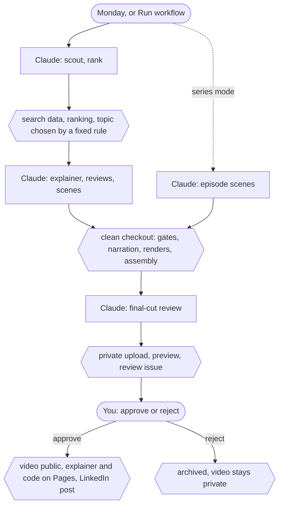

# Remaining Action: robotics explainers and their video series

The pipeline behind **Remaining Action**, a YouTube channel that explains robotics and control research with the
equations and the code. It turns a verified HTML explainer, or current robotics news, into narrated Manim videos:
every number printed by a script, every reference checked against a record, independent reviewers, render checks and
hard gates. A coding agent does the work (its instructions are in AGENTS.md); you watch each video and upload it.

## Quick start: a cloud session

One Claude Code cloud session, one command: it plans the series of a source document when none exists, makes the
next episode with every check and review, renders it and sends you the finished files. Nothing is uploaded for you.

### Once: the cloud environment

In Claude Code on the web, connect GitHub and pick this repository (it can be private). Then edit the environment the
sessions use (the environment menu in the session's title bar, then Edit):

1. **Network access**: **Limited** ("Custom" in an app that has not updated) with **Allow package managers** ticked.
   Under Allowed domains, add the Azure Speech hosts of your region (`swedencentral` here) for the channel voice:

   ```text
   swedencentral.tts.speech.microsoft.com
   swedencentral.api.cognitive.microsoft.com
   ```

   The keyless Piper voice (`voice.service` `piper` in `config/channel.json`) needs `huggingface.co`, `hf.co` and
   `*.hf.co` instead.
2. **Environment variables**: `AZURE_SUBSCRIPTION_KEY` and `AZURE_SERVICE_REGION` (`swedencentral`), the key and
   region of your Azure Speech resource.
3. **Setup script** (it runs as root on Ubuntu 24.04 in the folder above the repository; change the folder name if
   yours differs):

   ```text
   #!/bin/bash
   set -e
   cd claude_robotics_explainer
   ./setup.sh --with-system-deps --no-browser
   .venv/bin/python -m pip install -r requirements-voice.txt
   ```

   It installs the system packages, `.venv`, the npm packages and the Azure Speech SDK; the first session spends some
   minutes here. `--no-browser` skips Chromium, which only new explainers need. Without a setup script, ask the
   session to run `bash setup.sh --with-system-deps --no-browser`.

Loosen nothing else: `.claude/settings.json` already allows the pipeline's commands and denies `git push` and uploads.
In **Auto** mode (when your organization offers it) most commands run without asking.

### Once: the YouTube channel

- In YouTube Studio, set the channel audience to "not made for kids".
- Verify the channel by phone (youtube.com/verify) so custom thumbnails work.
- Every upload follows the checklist in its `upload_sheet.md`, including altered or synthetic content "Yes" for the
  AI narration.

### Each episode

1. Open a new session on the repository and type `/produce-from-source sources/variational-whole-body-control`. The
   first time, it plans the series (no approval needed: `series.plan_approval` is `optional` in
   `config/pipeline.json`), sends you the plan files and makes episode 1. Later sessions take the episode number,
   `/produce-from-source sources/variational-whole-body-control 2` (add `series <slug>` for another series); each
   session's report ends with the command for the next one.
2. Keep the session open until it hands over: scenes, checks, reviews and the 1080p render take hours.
3. Download what it sends, in that session (the container is temporary): `upload_sheet.md` (title, description,
   tags, chapters, settings, the YouTube Studio checklist), the MP4 and its `.srt`, `thumbnail.jpg`,
   `final_cut_review.md`, `youtube.json`, `SHA256SUMS`, and the first time the plan files: commit those under
   `series/<slug>/` in your copy of the repository and push, or the next session plans again.
4. Watch the video and upload it in YouTube Studio with the sheet.

When something is missing, the session says what: a host the network refused (add it under Allowed domains), the
setup command that failed (fix the setup script); then start a new session. A session without subagents says so at
the start: its red team and final-cut review are not independent, so it hands over the plan before any episode.

## Local setup (Linux, macOS, WSL)

Python 3.11 or newer, Node.js 18 or newer; on Windows, use WSL. In a terminal in the project folder (bash or zsh):

```bash
./setup.sh --check
./setup.sh
```

`--check` lists what is missing and changes nothing; for missing system packages (Cairo and Pango headers, ffmpeg,
TeX Live with dvisvgm, Node.js, the DejaVu fonts) it prints the apt or Homebrew command, and `./setup.sh
--with-system-deps` runs it first. `./setup.sh` builds `.venv` (Manim, manim-voiceover, the scientific stack, Piper),
installs the npm packages and Chromium and downloads the Piper voice. The channel voice also needs
`.venv/bin/python -m pip install -r requirements-voice.txt` and `AZURE_SUBSCRIPTION_KEY` and `AZURE_SERVICE_REGION`
in the environment, never in a file. If `./setup.sh` says "permission denied" (an unzip tool dropped the executable
bit):

```bash
chmod +x setup.sh tools/*.sh tools/ci/*.sh
```

Then start your coding agent in the folder: for Claude Code, `claude`, and accept the workspace trust dialog (the
hooks and allow rules need it). Manim installation problems and their fixes are in
`.agents/skills/manim-video-producer/manim-setup.md`.

### macOS (zsh)

macOS 13 or newer, Apple Silicon or Intel, with Homebrew (brew.sh):

```bash
./setup.sh --with-system-deps
```

It runs `brew install python@3.13 pkg-config cairo pango fontconfig ffmpeg sox node` and `brew install --cask
mactex-no-gui font-dejavu`, then the setup above. For a smaller TeX, install the packages yourself with BasicTeX in
place of MacTeX:

```bash
brew install python@3.13 pkg-config cairo pango fontconfig ffmpeg sox node
brew install --cask basictex font-dejavu
```

then, in a new terminal:

```bash
sudo tlmgr update --self
sudo tlmgr install standalone preview dvisvgm babel-english
./setup.sh
```

If a new terminal does not find `brew` (Apple Silicon) or `latex`, add them to your profile (`~/.bashrc` in bash) and
open a new terminal:

```bash
echo 'eval "$(/opt/homebrew/bin/brew shellenv)"' >> ~/.zshrc
echo 'export PATH="$PATH:/Library/TeX/texbin"' >> ~/.zshrc
```

macOS's own `python3` (3.9) and bash (3.2) are fine: `setup.sh` builds `.venv` with Homebrew's Python, and the
scripts run under bash 3.2. The Claude Code hooks run on the first `python3` in PATH and need 3.7 or newer; with an
older one they block every guarded action. Without the DejaVu fonts the scenes render with another font, which
changes text widths. Not yet tested on a Mac.

### Running it locally

- `/produce-from-source sources/<name>` works as in the cloud; the hand-over stays in `runs/<run>/deliver/`.
- `/produce-explainer [focus]` runs the news stages, then makes and finishes the video the same way.
- With `"topic_approval": "human"` in `config/pipeline.json` it stops after the ranking for you to type
  `/approve-topic runs/<run> <topic-id>`. If hooks are off (workspace not trusted, or an agent without hooks), run
  `python3 tools/human/approve_topic.py runs/<run> <topic-id>` yourself, in your own terminal.
- `python3 tools/run.py status runs/<run>` shows where a run stands; `/produce-explainer resume runs/<run>` continues.

## Adding a new source

1. Make `sources/<name>/` (lowercase words joined by hyphens) with `explainer.html`, one self-contained page.
2. Companion scripts go in its `code/`, with a `checks.toml` listing them (format: `templates/run/checks.toml`) and a
   `README.md` mapping scripts to sections; their input files in `data/`. `python3 tools/run_code_checks.py
   sources/<name>` runs them in a temporary copy (only `code/logs/` changes). Without companion code, each episode
   writes the scripts behind the numbers it shows.
3. `python3 tools/check_source.py sources/<name>`: errors stop `/produce-from-source` and the checks workflow,
   warnings are listed, each with its fix. A script tag that a viewer added when the page was saved goes with
   `--strip-external-scripts --write`.
4. Commit and push, open a new session and type `/produce-from-source sources/<name>`.

## Layout

```
AGENTS.md            instructions for coding agents (CLAUDE.md imports it)
SETUP-AUTOMATION.md  the optional GitHub automation
.agents/skills/      one skill per stage: SKILL.md and its supporting files
.claude/             agents/ (reviewer prompts), rules/, workflows/, settings.json; skills links to .agents/skills
.github/             workflows: pipeline, publish, archive, approve by label, CI image, checks
ci/                  Claude Code settings for CI
config/              your preferences: rubric, scout, search, pipeline, channel, video
docker/              the CI image
series/              series plans (series/README.md)
sources/             source documents: explainer, companion code, data
templates/           explainer/ (page), manim/ (scene helpers, voice), run/ (copied into new runs)
tests/               unit tests, two dry runs, fixtures
tools/               deterministic scripts; video/, publish/ (CI only), hooks/, human/, ci/
runs/                your runs (git-ignored)
.cache/piper/        the Piper voice model (git-ignored)
```

A run folder, `runs/YYYY-MM-DD-<slug>/` (made by `tools/run.py new` or `tools/series.py start`):

```
run.json sources.json scores.json search.json ranking.*   news mode: scout, ranker, search data, ranking
selection.* | approval.json | episode.json                 the topic decision (automatic, yours, the series plan)
draft/            meta.json, outline.md, NN-name.html parts (the writer edits these)
references.json   bibliography with verification records
code/             scripts, checks.toml, README.md (script to section), figures/, logs/
explainer.html    built from draft/ by tools/build_explainer.py
review/           reviewer reports, verify/, summary.md, gates.md, design/, video/, final_cut/
video/            storyboard.md, scenes/, data/, plan.json, checks/, voice/, renders/, final/
deliver/          the hand-over package (tools/deliver.py)
publish/          stage.json (CI only)
```

## The automation (optional, not set up)



The GitHub workflow runs the same pipeline unattended: news every Monday, or a series episode when you start it. The
jobs that run Claude hold no publishing secret, and nothing is public until you approve the deployment, an approval
Claude cannot give. SETUP-AUTOMATION.md has the one-time setup.

## License

Copyright (c) 2026 Gianluca Garofalo. All rights reserved, for the code and the content (explainers, figures,
videos); see `LICENSE`. Videos are uploaded with the Standard YouTube License (`config/channel.json`). Third-party
packages, KaTeX and the Piper voice model keep their own licenses.

## Voice policy

The narrator is a synthetic voice, and the channel says so (owner decision, 2026-11-06).

- The narrator: Microsoft Azure AI Speech, `en-US-Steffan:DragonHDLatestNeural` ("Steffan"), prosody rate -8 % (about
  150 words per minute), `voice.narrator` in `config/channel.json`. "DragonHDLatest" follows Microsoft's latest model
  and cannot be pinned.
- One narrator per series: the voice changes only at a series boundary, announced, and the series' back catalogue is
  re-voiced.
- An AI voice is never presented as a real person, nor several as different people; a second voice appears only as a
  named, disclosed character.
- AI narration is always disclosed: in the description (`tools/video/metadata.py`) and in the upload sheet's
  "altered or synthetic content" item (`tools/deliver.py`).
- The narration WAVs of every released episode are archived with the run.
- At each voice change, and whenever the model may have moved, `python3 tools/video/voice_reference.py` renders a
  fixed paragraph to `voice-reference/` (git-ignored): listen against the previous one before a new episode ships.
- Pauses come from the speech service only (punctuation, `<break>`, the prosody rate); the audio is never cut or
  spliced, and a faulty take is synthesized again, whole.
